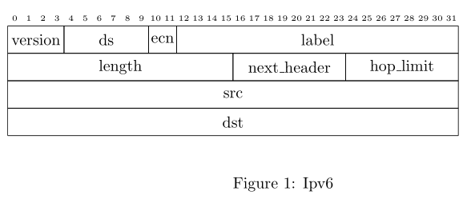

# deku-display
[](https://github.com/wcampbell0x2a/deku-display)
[](https://crates.io/crates/deku-display)
[](https://docs.rs/deku-display)
[](https://github.com/wcampbell0x2a/deku-display/actions?query=branch%3Amaster)

Create LaTeX [bytefield](https://www.ctan.org/pkg/bytefield) and reStructuredText [sphinxcontrib-bitfield](https://pypi.org/project/sphinxcontrib-bitfield/) diagrams from the Rust types of the [deku](https://github.com/sharksforarms/deku) library.

* **Derive**: Add `#[derive(DekuDisplay)]` to a type, and get its LaTeX or reStructuredText diagram.
* **CLI**: Run `deku-display-cli` on your source files. You do not change the code.
* See the [book](https://wcampbell0x2a.github.io/deku-display/) for usage, every attribute, and example diagrams.

## Installation
```console
$ cargo add deku-display
$ cargo install --locked --git https://github.com/wcampbell0x2a/deku-display deku-display-cli
```

## Example
```rust
use deku::prelude::*;
use deku_display::prelude::*;

#[derive(DekuDisplay, DekuRead, DekuWrite)]
#[deku_display(bit_width = 32)]
struct Ipv6 {
    #[deku(bits = "4")]
    version: u8,
    #[deku(bits = "6")]
    ds: u8,
    #[deku(bits = "2")]
    ecn: u8,
    #[deku(bits = "20")]
    label: u32,
    length: u16,
    next_header: u8,
    hop_limit: u8,
    src: u32,
    dst: u32,
}
```

`Ipv6::latex_output()` gives a bytefield figure, and `pdflatex` makes this:



Or, without a change to the code:
```console
$ deku-display-cli src/*.rs --format rst --output protocol.rst
```

## Development
All patches/merge requests are welcome!

```
just test   # run all the tests
just book   # build the book
```
