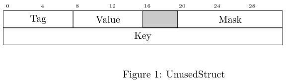

# Attributes

You can use the `#[deku_display]` attributes alone, or with the `#[deku]` attributes.

| Attribute                 | Scope     | Library            | Description                                       |
|---------------------------|-----------|--------------------|---------------------------------------------------|
| [bits](#bits)             | field     | deku, deku_display | Set the size of the field in bits                 |
| [unused](#unused)         | field     | deku_display       | Make the field gray, and remove its name          |
| [bit_width](#bit_width)   | top-level | deku_display       | Set the number of bits in each row                |
| [bitheader](#bitheader)   | top-level | deku_display       | Set the bit numbers above the LaTeX figure        |

## bits

Set the size of the field in bits. Use `#[deku_display(bits = ..)]` when deku does not
know the size, for example for a field with a nested type. If you do not set `bits`, the
size comes from the type of the field.

See [deku bits](https://docs.rs/deku/latest/deku/attributes/index.html#bits).

## unused

Make the field gray, and remove its name from the diagram. Use it for reserved bits.

```rust,noplayground
use deku::prelude::*;
use deku_display::prelude::*;

#[derive(DekuDisplay, DekuRead, DekuWrite)]
#[deku_display(bit_width = "32", bitheader = "0, 4, 8, 12, 16, 20, 24, 28")]
struct UnusedStruct {
    Tag: u8,
    Value: u8,
    #[deku_display(unused)]
    #[deku(bits = "4")]
    c: u8,
    #[deku(bits = "12")]
    Mask: u16,
    Key: u32,
}
```



## bit_width

Set the number of bits in each row of the diagram.

## bitheader

Set the bit numbers above the LaTeX figure. The default is `0-(bit_width - 1)`.
